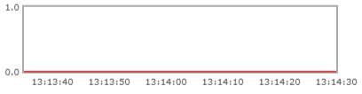
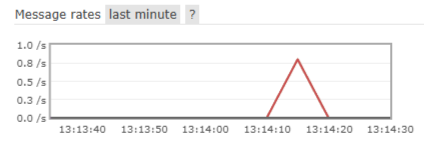
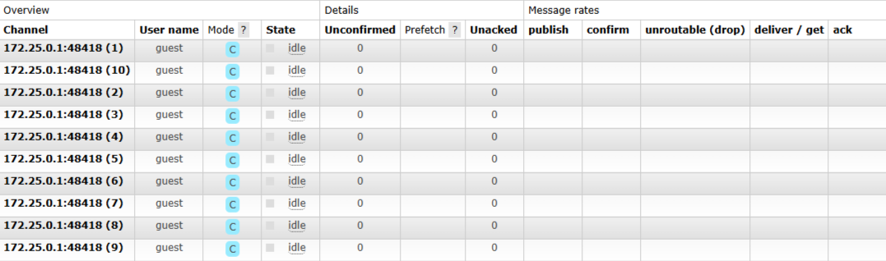

## Зачем нужен RabbitMQ?
- В сложных системах, где сервисы взаимодействуют между собой, можно организовать общение сервисов через внешний API, но это идея не самая логичная так как мы встретимся с проблемами, сервис-получатель недоступен, вызывающий сервис либо ждёт, либо падает. Это приводит к каскадным отказам и плохой масштабируемости. Лучше использовать брокеры сообщений такой как `RabbitMQ` который создает очередь сообщений и передает их между издателем и потребителем.

## Что такое RabbitMQ?
- RabbitMQ — это брокер сообщений. Выступает посредником между сервисами: producer отправляет сообщение в exchange, указав routing key маршрутизирует их через exchange смотрит на binding key сравнивая ключи:
  - direct — routing key == binding key (точное совпадение)
  - fanout — ключи игнорируются, шлёт во все очереди
  - topic — сопоставление по шаблону 
 доставляет consumer.  Обеспечивает буферизацию, гарантию доставки и гибкую маршрутизацию.

Путь сообщения:

```
producer ──publish──▶ exchange ──bindings──▶ queue ──push──▶ consumer
```

Зачем прослойка? Разделение ответственности:

- **producer** знает только «я шлю событие `order.created` в `taxi.events`» — он не знает и не хочет знать, кто и сколько его слушает;
- **exchange** — чистая функция маршрутизации: (сообщение, routing key) → множество очередей по таблице bindings. У него нет состояния, он ничего не хранит;
- **queue** — буфер: хранит сообщения, пока их не заберут и не подтвердят;
- **binding** — связь «exchange → очередь» с ключом; правила маршрутизации живут здесь, их можно менять на живом брокере, не трогая код продюсеров.

## Плюсы RabbitMQ:

1. Асинхронность — producer не ждёт consumer.
2. Гарантия доставки — ack/nack, persistent messages, durable queues.
3. Гибкая маршрутизация — 4 типа exchange: direct, fanout, topic, headers.

## Минусы / сложности RabbitMQ:

1. Eventually consistent — не подходит для запрос-ответ в реальном времени.
2. Нужно думать об идемпотентности.
3. Дополнительная инфраструктура — сам брокер нужно поднимать, мониторить.
4. Сложнее отлаживать, чем прямой HTTP-вызов.

## Модель AMQP 

### Connection против channel

- **Connection** — это одно TCP-соединение с брокером: дорогое (handshake, аутентификация), его держат по одному на процесс.
  - TCP-рукопожатие + AMQP-рукопожатие (несколько round-trip: представление клиента, согласование `frame_max`, числа каналов и heartbeat, аутентификация, `open`);
  - при необходимости TLS;
  - **heartbeat** — служебные кадры, которыми обе стороны подтверждают живость (по умолчанию 60 сек; по отсутствию кадров соединение считается мёртвым и закрывается).

  Connection **дорогой**: несколько round-trip на установку, сокеты и память на стороне брокера.

- Channel — лёгкий «виртуальный канал» внутри этого соединения: их могут быть десятки, каждый под свой поток задач. 

 - Ключевые следствия:

  1. **Channel не потокобезопасен.** Один канал — одна логическая сессия: один поток / одна asyncio-задача. Два консьюмера — два канала. В aio-pika: `await connection.channel()` на каждую независимую роль (канал продюсера, канал консьюмера).
  2. **Ошибки канала изолированы.** Классические channel-ошибки (канал закрывается, соединение остаётся живым):
    - `404 NOT_FOUND` — publish в несуществующий exchange;
    - `406 PRECONDITION_FAILED` — redeclare очереди/exchange с *другими аргументами*, чем объявлены (частая ошибка: поменял аргумент в коде, брокер помнит старые);
    - `406 PRECONDITION_FAILED` — consumer timeout (день 10);
    - `403 ACCESS_REFUSED` — нет прав на vhost.
    
    Код обязан уметь пересоздавать канал после таких ошибок — в pika/aio-pika это обычно `RobustConnection/RobustChannel`.
  3. Каналы дёшевы, но не бесплатны: у каждого есть состояние (открытые консьюмеры, unacked, confirms). Десятки на соединение — норма; тысячи — уже тревога.

**В Management UI** это видно буквально: вкладка *Connections* — по строке на TCP-соединение, вкладка *Channels* — по строке на канал (у каждого видно родительское соединение, число unacked, prefetch).

## Неотмаршрутированные сообщения

**По умолчанию — оно молча удалено.** Ни ошибки клиенту, ни лога, ни метрики в UI. Это осознанный дизайн AMQP (fire-and-forget), но на практике — главный способ тихо потерять события из-за опечатки в routing key или забытом binding'е. Два уровня защиты:

### 1) `mandatory=True`

Флаг метода `basic.publish`. Если сообщение не маршрутизируется никуда, брокер **возвращает его отправителю** методом `basic.return` — на тот же канал. Клиент должен повесить обработчик возвратов:

- в pika: `channel.add_on_return_callback(...)` + флаг `mandatory=True` в publish;
- в aio-pika: `publish(..., mandatory=True)` — при включённом режиме `on_return_raises` публикация unroutable-сообщения бросает `UnroutableError`.

Ограничение: это проверка «на месте», в момент publish — она ловит проблемы маршрутизации, но не гарантирует ничего дальше.

### 2) Alternate exchange (AE)

Аргумент при объявлении exchange: `x-alternate-exchange: <имя>`. Все unroutable-сообщения **переиздаются в этот exchange**. Обычно AE — fanout, ведущий в очередь `unroutable`: единая «почта невостребованных» для всех продюсеров данного exchange'а. Если у AE есть свой AE — цепочка продолжается.


### Эксперимент №1 Опубликовать сообщение с routing key, под который нет ни одного binding.

**Цель**

- Отправить сообщение с **produser** в обменник RabbitMQ, в несуществующий binding

**Ожидания**
- Отправляя запись в обменник с **routing key**, к которому не подойдет **binding key**, запись просто потеряется и все


**Ход**
1. Запускаем `produser` с неправильным **routing key** который не сможет передать в очередь по **binding key** записи.
2. Отправляем запросы

**Результат** 

**Queued messages**



**Message rates**



- В **RabbitMQ Managment** на графиках **Queued messages** мы не видим, что записи добавляются в очередь, но на графике **Message rates** мы видим активности записи передаются, из этого можно сделать вывод, что данные тихо удаляются при передачи не корректного **routing key** в обменник. 


### Эксперимент №2 1 Connection + 10 Channels.

**Цель**

Показать, что RabbitMQ спроектирован так, чтобы использовать одно TCP-соединение (Connection) и много логических каналов (Channels) внутри него. Это фундаментальная архитектурная концепция AMQP.

**Ход**
- Создать 10 соединений через цикл `range(10)`

**Результат**



- Connection — это TCP-соединение. Оно дорогое: требует TCP handshake, аутентификации, выделения памяти и процесса Erlang на стороне брокера.
- Channel — это виртуальное соединение (логический "поток" внутри TCP-соединения). Оно дешёвое: создаётся за микросекунды, почти не потребляет память, и RabbitMQ может держать миллионы каналов одновременно.

**Вывод**

- Использование одного соединения с множеством каналов вместо множества 
отдельных соединений позволяет:

1. Экономить ресурсы:
   - Меньше TCP-соединений (1 вместо 10)
   - Меньше портов на сервере
   - Меньше памяти на буферы
   - Меньше процессов Erlang на стороне RabbitMQ

2. Ускорить работу:
   - Создание канала: ~1мс
   - Создание соединения: ~100мс (TCP handshake + аутентификация)


### Эксперимент №3: Проверка буферизации 

**Цель**
- проверить, что при остановленном consumer'е сообщения не теряются, а накапливаются в очереди, и обрабатываются после его запуска.

**Ожидания**
- Броккер не потеряет ни единого заказа и при запуске `consumer.py` обработает все накапившиеся запросы.

**Ход:**
1. Запускаем FastAPI и RabbitMQ, но не запускаем consumer
2. Отправляем запросы
3. Заходим **RabbitMQ Managment** и на графике **Queued messages** увидим количество сделанных запросов, которые должны совпасть
4. Запускаем `consumer.py` и видим что все сделанные запросы выполнились.

**Вывод:**
- RabbitMQ буферизует сообщения, пока consumer недоступен. Producer не блокируется и не знает о состоянии consumer'а.


### Эксперимент №4: Проверка распарсинга данных

**Цель**
- Испортить ключи которые передают информацию из очереди в `consumer.py` и посмотреть как будет вести себя очередь.

**Ожидания**
- Данные не потреряются и просто останутся в очереди.

**Ход:**
1. Запускаем FastAPI, RabbitMQ и consumer и в нем портим ключи
2. Отправляем 3 запроса

**Вывод:**
- При некорректных ключах в `consumer` данные не обрабатываются и выходит ошибка `Task exception was never retrieved`
- В **RabbitMQ Management** на графике видим:
  - Скачок на линии **Deliver (manual ack)** — сообщения доставлены consumer'у
  - Скачок на линии **Redelivered** — сообщения возвращались в очередь
- Поля **Ready** и **Total** не равны нулю → данные **не потерялись** и остались в очереди

**Итог:**  
Эксперимент подтвердил ожидания: RabbitMQ **гарантирует доставку** сообщений даже при ошибках в consumer. Сообщения не теряются, а накапливаются в очереди до исправления кода. Это критически важно для надёжных систем.

### Эксперимент №5: Масштабирование

**Цель**
- Запустить несколько `consumer` и проверить как будет вести себя RabbitMQ.

**Ход:**
- Запустим в двух терминалах `consumer.py` 
- Сдеаем 6 заказов через API

**Результат:**  
Каждый consumer обработал ровно по 3 заказа.

**Вывод:**  
RabbitMQ автоматически распределяет сообщения между consumer'ами по принципу **round-robin** (по очереди). Это позволяет **горизонтально масштабировать** систему: при росте нагрузки можно просто добавить ещё один consumer, и RabbitMQ сам разделит работу поровну.

**Практическая ценность:**
- Нет необходимости вручную балансировать нагрузку
- Можно добавлять consumer'ы "на лету" без изменения кода producer'а
- Система устойчива к пиковым нагрузкам

## Гарантии доставки

| Механизм | Где живёт | Что гарантирует | Чего **не** гарантирует |
|---|---|---|---|
| `durable=True` |exchange/queue | переживёт рестарт брокера | ничего про сообщения: очередь после рестарта может быть пустой |
| `delivery_mode=2` (`PERSISTENT`) | свойство сообщения | сообщение **записано на диск** | ничего про очередь: если очередь исчезла, сообщение исчезло вместе с ней; и ничего про знание продюсера |
| publisher confirms | протокол клиент↔брокер | брокер **подтвердил приём** сообщения | ничего про диск у classic-очередей (см. 2.4); ничего про то, что сообщение кто-то обработал |

- При использовании всех трех механизмов, у нас гарантированно сообщение переживёт рестарт и оно сохранится на диске. 

## Quorum queues — дефолт для важных очередей в 4.x

В RabbitMQ 4.0 удалены mirrored queues. Для отказоустойчивости теперь используем Quorum Queues — они обеспечивают репликацию через протокол Raft и являются дефолтом для критичных данных

##  At-least-once, at-most-once и миф об exactly-once

Три модели доставки:

1. **At-most-once (Максимум один раз):** 
 - Сообщение будет доставлено не более одного раза. Допускается потеря сообщения, но гарантируется полное отсутствие дубликатов.  

2. **At-least-once (Как минимум один раз):** 
 - Сообщение будет доставлено как минимум один раз. Гарантируется, что сообщение не потеряется, но допускается повторная доставка (дубликаты) в случае сбоев сети или таймаутов. 

3. **exactly-once (Ровно один раз):**
 -  В распределённых системах (включая RabbitMQ) физически недостижимо на уровне транспорта из-за сетевых разделений, может сеть плохо работать, вылет тайутов. На практике мы это реализуем через `At-least-once + иденпотентность` мы допускаем, что брокер может доставить дубликат, но консьюмер сам проверяет уникальность сообщения и отфильтровывает повторы.


### Эксперимент №6: Матрица из четырёх прогонов: (transient queue / durable queue) × (transient message / persistent message).

**Цель**

- Сделать прогон при разном настройки очереди и сообщения 

**Ожидание**

- Выживут сообщения только в сценарии durable queue + persistent message. Во всех остальных случаях данные будут потеряны.

||Очередь|Сообщение|Выжило|
|----|----|----|----|
|1|durable=False|delivery_mode=NOT_PERSISTENT|0|
|2|durable=False|delivery_mode=PERSISTENT|0|
|3|durable=True|delivery_mode=NOT_PERSISTENT|0|
|4|durable=True|delivery_mode=PERSISTENT|100|


**Ход**

1. Запускаем скрипт, который поочерёдно создаёт 4 очереди с разными настройками и отправляет в каждую по 100 сообщений.
2. После делаем docker kill rabbitmq и docker start rabbitmq.
3. Заходим **RabbitMQ Managment** и смотрим количество выживших сообщений в каыждой очереди.


**Результат**

- Сохранилось 100 записей в брокере сообщений при рестарте только у очереди с настройками **durable** и **persistent**

### Эксперимент №7: confirms вкл/выкл при смерти брокера:

**Цель**
- Проверить, как поведёт себя продюсер, если брокер RabbitMQ будет убит `docker kill` в момент отправки сообщения, при включенных и выключенных `publisher_confirms`.

**Прогноз**
- **Без `publisher_confirms`:** Продюсер считает, что сообщение отправлено, и возвращает клиенту `200 OK`. Но так как брокер умер до записи на диск, сообщение теряется. Происходит «тихий сбой».
- **С `publisher_confirms` (вкл):** Продюсер ждёт подтверждения (ACK) от брокера. Так как брокер умирает, подтверждение не приходит. Продюсер получает исключение (ошибку сети/канала), прерывает операцию и возвращает клиенту `500` (честный сбой). Данные не теряются, так как клиент знает, что нужно повторить запрос.

**Ход**
1. Создаём канал с флагом `publisher_confirms=True`.
2. Отправляем сообщение в `durable` очередь с `delivery_mode=PERSISTENT`.
3. В момент выполнения `await publish()` принудительно убиваем контейнер: `docker kill <rabbitmq_container>`.
4. Смотрим на ответ API и логи Python.
5. (Опционально) Повторяем эксперимент, отключив `publisher_confirms`, чтобы сравнить поведение.

**Результат**
- При включенных `confirms` метод `publish` не завершился успешно. В логах Python появилось исключение:
  `ChannelInvalidStateError: No active transport in channel`
- Библиотека `connect_robust` автоматически начала попытки переподключения:
  `Connection attempt failed... Reconnecting after 5 seconds.`
- API вернул ошибку вместо ложного успеха.

**Вывод**
- `publisher_confirms` — это механизм обратной связи. Брокер отправляет продюсеру подтверждение (ACK) только после того, как физически сохранил сообщение.
- Без этого механизма продюсер работает вслепую и может потерять данные при сбое сети или падении брокера, даже не узнав об этом.
- С этим механизмом продюсер получает гарантию: если `await publish()` завершился без ошибок, данные 100% сохранены брокером.


## Потребление: prefetch, конкуренция, порядок

### prefetch:

- prefetch_count — сколько неподтверждённых сообщений consumer может держать одновременно.

1. Консьюмер получил сообщение → счётчик unacked растёт.
2. Пока счётчик < prefetch — брокер шлёт следующее.
3. Консьюмер сделал `ack` → счётчик уменьшился → брокер шлёт следующее.

 - без prefetch или prefetch_count=0:

    RabbitMQ заваливает consumer'а всеми сообщениями из очереди разом
    Consumer берёт 1000 сообщений в работу → все они в Unacked
    Если consumer упадёт — все 1000 вернутся в очередь

 - С prefetch_count=1:
    Consumer берёт одно сообщение, обрабатывает, подтверждает, берёт следующее
    Честное распределение между consumer'ами
    Но медленнее — пауза между «подтвердил» и «взял следующее»

 - С prefetch_count=10:
    Consumer держит до 10 сообщений «в работе»
    Хороший баланс: пока обрабатывает одно, следующие уже под рукой
    При падении вернутся максимум 10

**Синтаксис**
```
await channel.set_qos(prefetch_count=n)
```

## Как выбирать prefetch

Ориентир — закон Литтла: число сообщений «в полёте» = скорость обработки × время, которое сообщение может провести в полёте. 
Практически:

- **тяжёлые задачи** (десятки секунд): prefetch 1–5. Цель — справедливое распределение работы, а не скорость;
- **лёгкие однородные задачи** (миллисекунды): prefetch 10–100. Цель — скрыть round-trip, амортизировать издержки;


### Конкуренция (Competing consumers и порядок сообщений):

На одну очередь можно подписать несколько consumer'ов. RabbitMQ раскидывает сообщения между ними — это горизонтальное масштабирование обработки.

- Round-robin по умолчанию. Брокер по очереди отдаёт сообщения consumer'ам: 1-очередь, 2-очередь, 1-очередь, 2-очередь, ...
- С prefetch — consumer'у, у которого меньше «в работе» сообщений. Так быстрый consumer получает больше, медленный — меньше. 

## Consumer timeout

С версии 3.8.15 у RabbitMQ есть **consumer timeout**, по умолчанию **30 минут**: если доставленное сообщение не получило ack за это время, брокер закрывает канал ошибкой `PRECONDITION_FAILED` («consumer interval timed out»), а неподтверждённые сообщения возвращает в очередь.

### Эксперимент №8 Два консьюмера, 100 сообщений, `prefetch=0` vs `prefetch=1` vs `prefetch=50`

**Цель**
- Замерить общее время и распределение сообщений между консьюмерами.

**Ожидание**
- При **prefetch=0** разделение произойдет 50/50 так как время запроса и обработки одинаковое
- При **prefetch=1** сбалансированное разделение, я думаю тут разделится 50/50.
- При **prefetch=50** возможно небольшое отклонение, но близко к 50/50

**Ход**
- Запущены два консьюмера (consumer_1.py и consumer_2.py)
- Отправлено 100 сообщений через produser.py
- Замерено количество обработанных задач каждым консьюмером
- Повторено для prefetch=0, prefetch=1, prefetch=50


**Результат**
- При **prefetch=0** с ожиданием сошлось произошло разделение на 50 на 50 на каждый consumer
- При **prefetch=1** с ожиданием сошлось произошло разделение на 50 на 50 на каждый consumer
- При **prefetch=50** с ожиданием сошлось произошло разделение на 50 на 50 на каждый consumer


**Вывод**
- При однородных задачах с одинаковым временем обработки (~0.3 мс) все три режима prefetch (0, 1, 50) дают идеальное распределение 50/50. Это происходит потому, что оба консьюмера освобождаются практически мгновенно и успевают запросить следующее сообщение с одинаковой скоростью. RabbitMQ использует алгоритм Round-Robin, поочередно отдавая сообщения доступным консьюмерам.

**Изменим условия в эксперименте что время обработки будет разной**
```
delay = random.uniform(0.01, 1.0)
await asyncio.sleep(delay)
```

**Результат**
- При **prefetch=0** разделение произлшло 50 на 50 на каждый consumer
- При **prefetch=1** тут произошел перекос, второй принцип о конкурентности  
- При **prefetch=50** (100 сообщений): разделение 50/50

**Вывод**
- При однородных задачах с разными временем обработки от (0.1-1) мс в три режима prefetch (0, 1, 50). prefetch=0 (Round-Robin): Распределение осталось 50/50. RabbitMQ строго чередует выдачу сообщений, не учитывая реальную скорость обработки. prefetch=1 (динамическая балансировка): Произошёл небольшой перекос 52/48. RabbitMQ отдаёт новое сообщение только после получения ack от предыдущего. prefetch=50 (буферизация пачками): Распределение снова 50/50

### Эксперимент №9 Consumer Timeout

**Цель**
- Показать, что происходит, когда консьюмер берёт сообщение, но не успевает подтвердить его (ack) в течение заданного времени. RabbitMQ принудительно разорвёт канал и вернёт сообщение в очередь для повторной доставки.


## Отказы: ack/nack, DLX, retry с задержкой, идемпотентный консьюмер

### Ручные подтверждения и судьба requeue

При auto_ack=False у консьюмера три способа ответить брокеру о доставленном сообщении:

|Способ|Смысл|Флаг requeue|
|---|---|---|
|ack()|обработано|нет|
|nack(requeue=True/False)|не обработано|да|
|reject(requeue=True/False)|не обработано|да|

- requeue=True — сообщение возвращается в очередь.
- requeue=False — сообщение удаляется…

Правило выбора в обработчике ошибок:

- транзиентная ошибка (моргнула сеть, БД недоступна, таймаут внешнего сервиса) — обработка может пройти на следующей попытке → nack(requeue=True) или, лучше, retry-очередь с задержкой;
- детерминированная ошибка (битый JSON, неизвестный тип события, нарушение бизнес-правила) — на тысячной попытке результат тот же, что на первой → nack(requeue=False).

- Poison message — сообщение, которое стабильно валит обработчик
- hot loop: бесконечное вращение одного сообщения на полной скорости процессора

### Dead Letter Exchange (DLX)

Dead Letter Exchange — это обменник, с особой ролью: он принимает сообщения, которые не удалось доставить или обработать в обычном порядке. 

Сообщение попадает в DLX в трёх случаях:
1. nack(requeue=False) или reject(requeue=False) — явный отказ
2. Истечение TTL сообщения (x-message-ttl) — истек срок хранения ключа
3. Переполнение очереди (x-max-length) — очередь переполнена

Про переполнение — три режима `overflow`:

- `drop-head` (дефолт): выбрасываются **старейшие** сообщения — они становятся dead letter'ами и уходят в DLX, если он настроен;
- `reject-publish`: новые публикации отклоняются (с publisher confirms брокер отвечает nack'ом — продюсер узнает);
- `reject-publish-dlx`: отклонённые новые сообщения отправляются в DLX.

**Как настраивается**
- DLX — аргумент очереди, обычный exchange любого типа:
```
channel.queue_declare(
    queue='main.queue',
    arguments={
        'x-dead-letter-exchange': 'dlx.exchange',      # куда перенаправлять
        'x-dead-letter-routing-key': 'dead.letter',    # с каким routing key
        'x-message-ttl': 60000,                        # TTL 60 сек
        'x-max-length': 1000                           # максимум 1000 сообщений
    }
)
```

### Dead Letter Queue (DLQ)

Dead Letter Queue — это очередь, куда попадают сообщения из DLX

### Retry с задержкой

- Мгновенный `requeue=True` — это внешняя зависимость (БД) физически не успевает восстановиться между попытками. Задержка (exponential backoff) даёт системе время оздоровиться и снимает нагрузку с брокера.

```
[Основная очередь] → (ошибка) → [Буферная очередь с TTL=30с] → (TTL истёк) → [Основная очередь]
```

### Схема «TTL-буфер» 

```
order_queue ──nack(requeue=false)──▶ taxi.dlx ──(rk order.created)──▶ order_queue.retry
order_queue.retry:  x-message-ttl = 5000
                    x-dead-letter-exchange = taxi.events   ← ключ исходный (order.created)
после TTL: сообщение переиздаётся в taxi.events → снова order_queue
```

### Лимит попыток по x-death

Консьюмер перед обработкой читает `x-death[0].count`:

- `count < 3` → `nack(requeue=False)` → DLX → retry-очередь → через 5 сек обратно;
- `count >= 3` → **в DLQ навсегда**.

1. **Републикация консьюмером**: при `count >= 3` консьюмер сам публикует сообщение в DLQ-путь
2. **Многоуровневые retry-очереди**: цепочка `order_queue.retry.5s → order_queue.retry.30s → ...` с растущим TTL; консьюмер выбирает следующую републикацией по счётчику, последняя в цепочке dead-letter'ит в DLQ. Без републикации в саму DLQ не обойтись всё равно — брокер не знает о «лимитах попыток», это знание приложения.


## Идемпотентный консьюмер

### Ключ дедупликации

`event_id` — генерируется **продюсером** в момент публикации. Требование: один и тот же логический инцидент → один и тот же `event_id` при любых повторах. UUID-генерация на стороне приложения, не брокера.

### Вариант Redis: `SET ... NX EX`

```text
SET dedup:{event_id} 1 NX EX 86400
```

- `NX` — установить только если ключа нет; вернул `None` → **дубликат**: лог + `ack` + пропуск обработки;
- `EX 86400` — TTL сутки: дедуп-окно конечное, Redis не пухнет вечно;
- `NX` атомарен: два параллельных консьюмера с одним `event_id` — обработает ровно один (второй проиграет гонку SET'а).

### Дилемма порядка: SET до или после обработки

- **SET до обработки**: упали после SET, до обработки → событие помечено «сделанным», но не сделано → **потеря** (at-least-once деградировал до at-most-once).
- **обработка до SET**: между обработкой и SET окно, за которое параллельный дубликат успеет пройти проверку → двойная обработка.

- `NX` — установить только если ключа нет; вернул `None` → **дубликат**: лог + `ack` + пропуск обработки;
- `EX 86400` — TTL сутки: дедуп-окно конечное, Redis не пухнет вечно;
- `NX` атомарен: два параллельных консьюмера с одним `event_id` — обработает ровно один (второй проиграет гонку SET'а).

### Золотой стандарт: уникальный constraint в Postgres

```text
CREATE TABLE processed_events (event_id UUID PRIMARY KEY, processed_at timestamptz);
```

В **одной транзакции** с бизнес-изменением: `INSERT INTO processed_events ... ON CONFLICT DO NOTHING` → вставилось (0 конфликтов) — выполняем бизнес-логику и коммит; конфликт — дубликат, откатываемся и ack'аем. Атомарность «запомнить и сделать» достигается потому, что обе операции живут в одной транзакции — то, чего не может дать Redis.

### Естественная идемпотентность

Часто дедуп-таблица вообще не нужна, если операции идемпотентны по построению:

- `UPDATE orders SET status='assigned' WHERE id=$1 AND status='created'` — повторное применение меняет 0 строк;
- `INSERT ... ON CONFLICT (order_id) DO UPDATE` / `DO NOTHING` (upsert).
